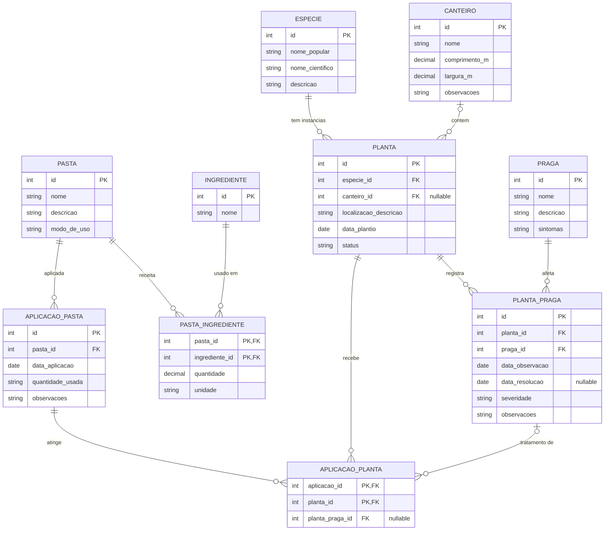

# Banco de dados: Horta Educacional

Modelo para gerenciar espécies, plantas individuais, pragas, canteiros e pastas (defensivos caseiros), com rastreabilidade de aplicações por planta.

## Decisões de modelagem

- **`especie`** é o tipo da planta. **`planta`** é a instância física, com localização em texto e canteiro opcional.
- **`planta_praga`** é a tabela N:N entre planta e praga, com histórico (datas de observação e resolução).
- **`canteiro_id`** em `planta` aceita `NULL`, para plantas em vaso ou fora de canteiros. A quantidade por espécie em um canteiro vem de `COUNT`.
- **`aplicacao_pasta`** é o evento (qual pasta, quando, quanto). **`aplicacao_planta`** liga o evento às plantas que receberam.
- **`aplicacao_planta.planta_praga_id`** (opcional) liga a aplicação à infestação que ela tentava combater. Uma chave estrangeira composta garante que a infestação pertence à mesma planta.
- **Receita** estruturada em `pasta_ingrediente`. O campo `modo_de_uso` guarda o passo a passo em texto.

## Diagrama (Mermaid)



## Criação das tabelas (MySQL 8.0.16+)

> Os `CHECK` só são aplicados a partir do MySQL 8.0.16. Em versões anteriores eles são aceitos, mas ignorados.

```sql
CREATE DATABASE IF NOT EXISTS horta_educacional
    CHARACTER SET utf8mb4
    COLLATE utf8mb4_unicode_ci;

USE horta_educacional;

-- ---------------------------------------------------------
-- Tabelas base
-- ---------------------------------------------------------

CREATE TABLE especie (
    id               INT UNSIGNED NOT NULL AUTO_INCREMENT,
    nome_popular     VARCHAR(100) NOT NULL,
    nome_cientifico  VARCHAR(150) NULL,
    descricao        TEXT NULL,
    PRIMARY KEY (id),
    UNIQUE KEY uq_especie_nome_popular (nome_popular)
) ENGINE=InnoDB;

CREATE TABLE canteiro (
    id             INT UNSIGNED NOT NULL AUTO_INCREMENT,
    nome           VARCHAR(100) NOT NULL,
    comprimento_m  DECIMAL(6,2) NULL,
    largura_m      DECIMAL(6,2) NULL,
    observacoes    TEXT NULL,
    PRIMARY KEY (id),
    UNIQUE KEY uq_canteiro_nome (nome),
    CONSTRAINT ck_canteiro_medidas
        CHECK (
            (comprimento_m IS NULL OR comprimento_m > 0) AND
            (largura_m IS NULL OR largura_m > 0)
        )
) ENGINE=InnoDB;

CREATE TABLE praga (
    id         INT UNSIGNED NOT NULL AUTO_INCREMENT,
    nome       VARCHAR(100) NOT NULL,
    descricao  TEXT NULL,
    sintomas   TEXT NULL,
    PRIMARY KEY (id),
    UNIQUE KEY uq_praga_nome (nome)
) ENGINE=InnoDB;

-- ---------------------------------------------------------
-- Planta (instância) e infestações
-- ---------------------------------------------------------

CREATE TABLE planta (
    id                     INT UNSIGNED NOT NULL AUTO_INCREMENT,
    especie_id             INT UNSIGNED NOT NULL,
    canteiro_id            INT UNSIGNED NULL,           -- nem toda planta está em canteiro
    localizacao_descricao  VARCHAR(255) NULL,           -- ex.: "vaso na janela da sala 3"
    data_plantio           DATE NULL,
    status                 ENUM('ativa', 'colhida', 'morta', 'removida')
                           NOT NULL DEFAULT 'ativa',
    PRIMARY KEY (id),
    KEY idx_planta_especie (especie_id),
    KEY idx_planta_canteiro (canteiro_id),
    CONSTRAINT fk_planta_especie
        FOREIGN KEY (especie_id) REFERENCES especie (id)
        ON UPDATE CASCADE ON DELETE RESTRICT,
    CONSTRAINT fk_planta_canteiro
        FOREIGN KEY (canteiro_id) REFERENCES canteiro (id)
        ON UPDATE CASCADE ON DELETE SET NULL
) ENGINE=InnoDB;

CREATE TABLE planta_praga (
    id               INT UNSIGNED NOT NULL AUTO_INCREMENT,
    planta_id        INT UNSIGNED NOT NULL,
    praga_id         INT UNSIGNED NOT NULL,
    data_observacao  DATE NOT NULL,
    data_resolucao   DATE NULL,                          -- NULL = infestação ainda ativa
    severidade       ENUM('leve', 'moderada', 'grave') NULL,
    observacoes      TEXT NULL,
    PRIMARY KEY (id),
    -- necessário para a FK composta de aplicacao_planta
    UNIQUE KEY uq_planta_praga_id_planta (id, planta_id),
    KEY idx_planta_praga_planta (planta_id),
    KEY idx_planta_praga_praga (praga_id),
    CONSTRAINT fk_planta_praga_planta
        FOREIGN KEY (planta_id) REFERENCES planta (id)
        ON UPDATE CASCADE ON DELETE CASCADE,
    CONSTRAINT fk_planta_praga_praga
        FOREIGN KEY (praga_id) REFERENCES praga (id)
        ON UPDATE CASCADE ON DELETE RESTRICT,
    CONSTRAINT ck_planta_praga_datas
        CHECK (data_resolucao IS NULL OR data_resolucao >= data_observacao)
) ENGINE=InnoDB;

-- ---------------------------------------------------------
-- Pastas, receitas e aplicações
-- ---------------------------------------------------------

CREATE TABLE pasta (
    id            INT UNSIGNED NOT NULL AUTO_INCREMENT,
    nome          VARCHAR(100) NOT NULL,
    descricao     TEXT NULL,
    modo_de_uso   TEXT NULL,
    PRIMARY KEY (id),
    UNIQUE KEY uq_pasta_nome (nome)
) ENGINE=InnoDB;

CREATE TABLE ingrediente (
    id    INT UNSIGNED NOT NULL AUTO_INCREMENT,
    nome  VARCHAR(100) NOT NULL,
    PRIMARY KEY (id),
    UNIQUE KEY uq_ingrediente_nome (nome)
) ENGINE=InnoDB;

CREATE TABLE pasta_ingrediente (
    pasta_id        INT UNSIGNED NOT NULL,
    ingrediente_id  INT UNSIGNED NOT NULL,
    quantidade      DECIMAL(10,2) NOT NULL,
    unidade         VARCHAR(20) NOT NULL,                -- g, ml, colher de sopa, dente...
    PRIMARY KEY (pasta_id, ingrediente_id),
    KEY idx_pasta_ingrediente_ing (ingrediente_id),
    CONSTRAINT fk_pasta_ing_pasta
        FOREIGN KEY (pasta_id) REFERENCES pasta (id)
        ON UPDATE CASCADE ON DELETE CASCADE,
    CONSTRAINT fk_pasta_ing_ingrediente
        FOREIGN KEY (ingrediente_id) REFERENCES ingrediente (id)
        ON UPDATE CASCADE ON DELETE RESTRICT,
    CONSTRAINT ck_pasta_ing_quantidade CHECK (quantidade > 0)
) ENGINE=InnoDB;

CREATE TABLE aplicacao_pasta (
    id               INT UNSIGNED NOT NULL AUTO_INCREMENT,
    pasta_id         INT UNSIGNED NOT NULL,
    data_aplicacao   DATE NOT NULL,
    quantidade_usada VARCHAR(50) NULL,                   -- texto livre: "1 litro", "2 borrifadas"
    observacoes      TEXT NULL,
    PRIMARY KEY (id),
    KEY idx_aplicacao_pasta (pasta_id),
    KEY idx_aplicacao_data (data_aplicacao),
    CONSTRAINT fk_aplicacao_pasta
        FOREIGN KEY (pasta_id) REFERENCES pasta (id)
        ON UPDATE CASCADE ON DELETE RESTRICT
) ENGINE=InnoDB;

CREATE TABLE aplicacao_planta (
    aplicacao_id     INT UNSIGNED NOT NULL,
    planta_id        INT UNSIGNED NOT NULL,
    planta_praga_id  INT UNSIGNED NULL,                  -- infestação que a aplicação tentava combater
    PRIMARY KEY (aplicacao_id, planta_id),
    KEY idx_aplicacao_planta_planta (planta_id),
    KEY idx_aplicacao_planta_praga (planta_praga_id),
    CONSTRAINT fk_apl_pl_aplicacao
        FOREIGN KEY (aplicacao_id) REFERENCES aplicacao_pasta (id)
        ON UPDATE CASCADE ON DELETE CASCADE,
    CONSTRAINT fk_apl_pl_planta
        FOREIGN KEY (planta_id) REFERENCES planta (id)
        ON UPDATE CASCADE ON DELETE CASCADE,
    -- garante que a infestação informada pertence à MESMA planta
    -- (com planta_praga_id NULL a verificação é ignorada pelo MySQL)
    CONSTRAINT fk_apl_pl_planta_praga
        FOREIGN KEY (planta_praga_id, planta_id)
        REFERENCES planta_praga (id, planta_id)
        ON UPDATE CASCADE ON DELETE RESTRICT
) ENGINE=InnoDB;
```

## Dados de exemplo (para testar os SELECTs)

```sql
INSERT INTO especie (nome_popular, nome_cientifico) VALUES
    ('Alface',   'Lactuca sativa'),
    ('Tomate',   'Solanum lycopersicum'),
    ('Manjericão', 'Ocimum basilicum');

INSERT INTO canteiro (nome, comprimento_m, largura_m) VALUES
    ('Canteiro A', 3.00, 1.20),
    ('Canteiro B', 2.50, 1.00);

INSERT INTO praga (nome, sintomas) VALUES
    ('Pulgão',      'Folhas enroladas e presença de insetos pequenos sob as folhas'),
    ('Lagarta',     'Folhas roídas e fezes escuras'),
    ('Cochonilha',  'Manchas algodonosas nos caules');

INSERT INTO planta (especie_id, canteiro_id, localizacao_descricao, data_plantio) VALUES
    (1, 1,    'Fileira 1, início do canteiro',  '2026-09-01'),  -- id 1
    (1, 1,    'Fileira 1, meio do canteiro',    '2026-09-01'),  -- id 2
    (2, 2,    'Fileira única, ao lado da cerca','2026-08-15'),  -- id 3
    (2, 2,    'Fileira única, centro',          '2026-08-15'),  -- id 4
    (3, NULL, 'Vaso na janela da sala 3',       '2026-10-05');  -- id 5 (sem canteiro)

INSERT INTO planta_praga (planta_id, praga_id, data_observacao, data_resolucao, severidade) VALUES
    (1, 1, '2026-10-10', NULL,         'moderada'),  -- id 1: pulgão ativo
    (2, 1, '2026-10-10', '2026-10-20', 'leve'),      -- id 2: pulgão resolvido
    (3, 2, '2026-10-12', NULL,         'grave');     -- id 3: lagarta ativa

INSERT INTO pasta (nome, descricao, modo_de_uso) VALUES
    ('Pasta de alho e sabão', 'Repelente caseiro contra insetos de corpo mole',
     'Bater o alho com a água, misturar o sabão e borrifar nas folhas no fim da tarde.');

INSERT INTO ingrediente (nome) VALUES ('Alho'), ('Sabão de coco'), ('Água');

INSERT INTO pasta_ingrediente (pasta_id, ingrediente_id, quantidade, unidade) VALUES
    (1, 1, 5,   'dentes'),
    (1, 2, 1,   'colher de sopa'),
    (1, 3, 1000,'ml');

-- Aplicação no Canteiro A inteiro (evento + plantas atingidas)
INSERT INTO aplicacao_pasta (pasta_id, data_aplicacao, quantidade_usada)
VALUES (1, '2026-10-14', '1 litro');

SET @aplicacao_id = LAST_INSERT_ID();

INSERT INTO aplicacao_planta (aplicacao_id, planta_id, planta_praga_id) VALUES
    (@aplicacao_id, 1, 1),     -- tratando o pulgão da planta 1
    (@aplicacao_id, 2, 2);     -- tratando o pulgão da planta 2
```

## Exemplos de SELECT

### 1. Espécies com pragas ativas e quantas plantas estão afetadas

```sql
SELECT e.nome_popular      AS especie,
       pr.nome             AS praga,
       COUNT(DISTINCT pl.id) AS plantas_afetadas
FROM planta_praga pp
JOIN planta pl  ON pl.id = pp.planta_id
JOIN especie e  ON e.id  = pl.especie_id
JOIN praga pr   ON pr.id = pp.praga_id
WHERE pp.data_resolucao IS NULL
GROUP BY e.nome_popular, pr.nome
ORDER BY plantas_afetadas DESC;
```

### 2. Percentual de plantas com praga ativa por espécie

```sql
SELECT e.nome_popular AS especie,
       COUNT(DISTINCT pl.id) AS total_plantas,
       COUNT(DISTINCT CASE WHEN pp.id IS NOT NULL THEN pl.id END) AS plantas_com_praga,
       ROUND(
           100 * COUNT(DISTINCT CASE WHEN pp.id IS NOT NULL THEN pl.id END)
               / COUNT(DISTINCT pl.id), 1
       ) AS percentual_com_praga
FROM especie e
JOIN planta pl ON pl.especie_id = e.id
LEFT JOIN planta_praga pp
       ON pp.planta_id = pl.id
      AND pp.data_resolucao IS NULL
GROUP BY e.id, e.nome_popular
ORDER BY percentual_com_praga DESC;
```

### 3. Plantas sem nenhuma praga ativa

```sql
SELECT pl.id, e.nome_popular, pl.localizacao_descricao
FROM planta pl
JOIN especie e ON e.id = pl.especie_id
WHERE NOT EXISTS (
    SELECT 1
    FROM planta_praga pp
    WHERE pp.planta_id = pl.id
      AND pp.data_resolucao IS NULL
);
```

### 4. Quantidade de plantas de cada espécie por canteiro

```sql
SELECT COALESCE(c.nome, '(sem canteiro)') AS canteiro,
       e.nome_popular                      AS especie,
       COUNT(*)                            AS quantidade
FROM planta pl
JOIN especie e        ON e.id = pl.especie_id
LEFT JOIN canteiro c  ON c.id = pl.canteiro_id
GROUP BY c.id, c.nome, e.id, e.nome_popular
ORDER BY canteiro, especie;
```

### 5. Plantas que estão fora de canteiros

```sql
SELECT pl.id, e.nome_popular, pl.localizacao_descricao
FROM planta pl
JOIN especie e ON e.id = pl.especie_id
WHERE pl.canteiro_id IS NULL;
```

### 6. Histórico de pragas de uma planta específica

```sql
SELECT pr.nome AS praga,
       pp.data_observacao,
       pp.data_resolucao,
       pp.severidade,
       CASE WHEN pp.data_resolucao IS NULL THEN 'ativa' ELSE 'resolvida' END AS situacao
FROM planta_praga pp
JOIN praga pr ON pr.id = pp.praga_id
WHERE pp.planta_id = 1
ORDER BY pp.data_observacao;
```

### 7. Histórico de pastas aplicadas em uma planta

```sql
SELECT ap.data_aplicacao,
       pa.nome AS pasta,
       ap.quantidade_usada,
       pr.nome AS praga_tratada
FROM aplicacao_planta apl
JOIN aplicacao_pasta ap      ON ap.id = apl.aplicacao_id
JOIN pasta pa                ON pa.id = ap.pasta_id
LEFT JOIN planta_praga pp    ON pp.id = apl.planta_praga_id
LEFT JOIN praga pr           ON pr.id = pp.praga_id
WHERE apl.planta_id = 1
ORDER BY ap.data_aplicacao;
```

### 8. Eficácia: infestações tratadas e resolvidas por pasta

```sql
SELECT pa.nome AS pasta,
       COUNT(*) AS tratamentos,
       COUNT(pp.data_resolucao) AS infestacoes_resolvidas,
       ROUND(100 * COUNT(pp.data_resolucao) / COUNT(*), 1) AS percentual_resolvido
FROM aplicacao_planta apl
JOIN aplicacao_pasta ap   ON ap.id = apl.aplicacao_id
JOIN pasta pa             ON pa.id = ap.pasta_id
JOIN planta_praga pp      ON pp.id = apl.planta_praga_id
GROUP BY pa.id, pa.nome
ORDER BY percentual_resolvido DESC;
```

### 9. Receita completa de uma pasta

```sql
SELECT pa.nome AS pasta,
       i.nome  AS ingrediente,
       pi.quantidade,
       pi.unidade,
       pa.modo_de_uso
FROM pasta pa
JOIN pasta_ingrediente pi ON pi.pasta_id = pa.id
JOIN ingrediente i        ON i.id = pi.ingrediente_id
WHERE pa.id = 1
ORDER BY i.nome;
```

### 10. Aplicações recebidas por um canteiro (via plantas atuais)

```sql
SELECT c.nome AS canteiro,
       ap.data_aplicacao,
       pa.nome AS pasta,
       COUNT(DISTINCT apl.planta_id) AS plantas_atingidas
FROM canteiro c
JOIN planta pl             ON pl.canteiro_id = c.id
JOIN aplicacao_planta apl  ON apl.planta_id = pl.id
JOIN aplicacao_pasta ap    ON ap.id = apl.aplicacao_id
JOIN pasta pa              ON pa.id = ap.pasta_id
WHERE c.id = 1
GROUP BY c.nome, ap.id, ap.data_aplicacao, pa.nome
ORDER BY ap.data_aplicacao;
```

### 11. Pragas mais frequentes (ranking geral, incluindo histórico)

```sql
SELECT pr.nome AS praga,
       COUNT(*) AS ocorrencias,
       COUNT(DISTINCT pp.planta_id) AS plantas_distintas
FROM planta_praga pp
JOIN praga pr ON pr.id = pp.praga_id
GROUP BY pr.id, pr.nome
ORDER BY ocorrencias DESC;
```

## Como registrar uma aplicação no canteiro inteiro

Em uma transação, crie o evento e insira todas as plantas do canteiro naquele momento:

```sql
START TRANSACTION;

INSERT INTO aplicacao_pasta (pasta_id, data_aplicacao, quantidade_usada, observacoes)
VALUES (1, CURDATE(), '2 litros', 'Aplicação preventiva no canteiro todo');

SET @aplicacao_id = LAST_INSERT_ID();

INSERT INTO aplicacao_planta (aplicacao_id, planta_id)
SELECT @aplicacao_id, id
FROM planta
WHERE canteiro_id = 1
  AND status = 'ativa';

COMMIT;
```

Isso guarda quais plantas estavam no canteiro **naquele dia**. Se uma planta for movida depois, o histórico continua correto.