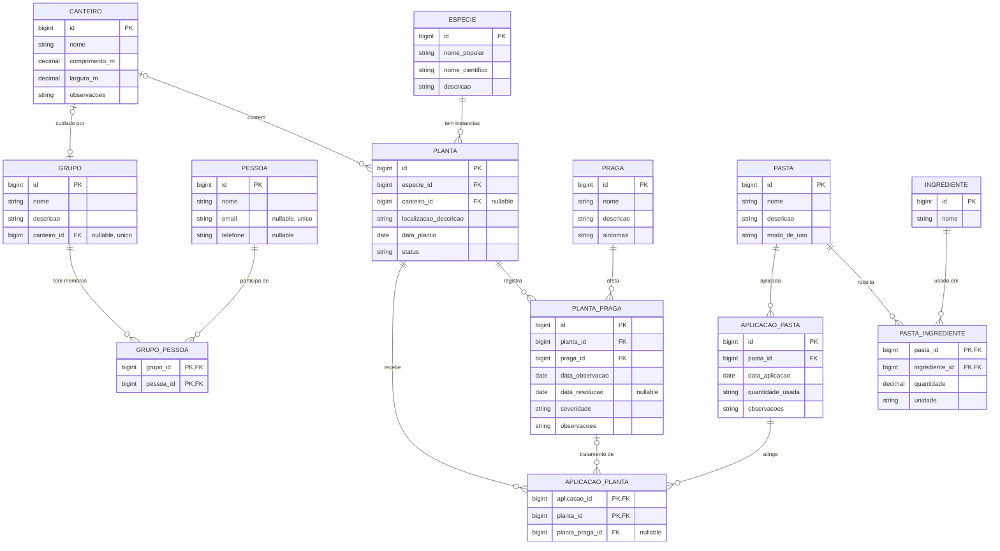

# Horta Comunitária

App para gerenciar uma horta comunitária: espécies, plantas, canteiros, pragas, pastas (defensivos caseiros) e as pessoas e grupos que cuidam de cada canteiro, com histórico das aplicações em cada planta.

Um código só para celular e computador: site responsivo, pensado primeiro para o celular.

## Tecnologias

| Parte | Escolha |
|---|---|
| Tela e servidor | [Next.js 16](https://nextjs.org) (App Router, TypeScript) |
| Visual | Tailwind CSS 4 |
| Banco, login e arquivos | [Supabase](https://supabase.com) (PostgreSQL) |
| Gerenciador de pacotes | pnpm |

## Como rodar

1. Instale as dependências:

   ```bash
   pnpm install
   ```

2. Crie um projeto no [Supabase](https://supabase.com/dashboard) e aplique o banco. Há dois jeitos:
   - **Pelo painel:** abra o *SQL Editor*, cole e rode [`supabase/migrations/20261119120000_schema_inicial.sql`](supabase/migrations/20261119120000_schema_inicial.sql). Se quiser dados de teste, rode depois [`supabase/seed.sql`](supabase/seed.sql).
   - **Pela linha de comando:**

     ```bash
     pnpm dlx supabase login
     pnpm dlx supabase link --project-ref SEU-PROJETO
     pnpm dlx supabase db push
     ```

3. Copie `.env.example` para `.env.local` e preencha a URL e a chave **pública** (*publishable*) do projeto (*Project Settings > API Keys*). A chave secreta nunca entra no app.

4. Suba o app:

   ```bash
   pnpm dev
   ```

   Abra <http://localhost:3000>. A página inicial lista os canteiros e as espécies cadastradas.

## Estrutura de pastas

```
src/
  app/                 páginas (App Router)
  lib/supabase/
    server.ts          cliente do Supabase para o servidor (lê a sessão nos cookies)
    client.ts          cliente do Supabase para componentes "use client"
supabase/
  migrations/          criação do banco, em ordem de data
  seed.sql             dados de exemplo
```

---

## Banco de dados

### Decisões de modelagem

- **`especie`** é o tipo da planta. **`planta`** é a instância física, com localização em texto e canteiro opcional.
- **`planta_praga`** é a tabela N:N entre planta e praga, com histórico (datas de observação e resolução).
- **`canteiro_id`** em `planta` aceita `NULL`, para plantas em vaso ou fora de canteiros. A quantidade por espécie em um canteiro vem de `COUNT`.
- **`aplicacao_pasta`** é o evento (qual pasta, quando, quanto). **`aplicacao_planta`** liga o evento às plantas que receberam.
- **`aplicacao_planta.planta_praga_id`** (opcional) liga a aplicação à infestação que ela tentava combater. Uma chave estrangeira composta garante que a infestação pertence à mesma planta.
- **Receita** estruturada em `pasta_ingrediente`. O campo `modo_de_uso` guarda o passo a passo em texto.
- **`pessoa`** guarda nome, e-mail e telefone. E-mail e telefone são opcionais (nem todo voluntário tem os dois), mas o mesmo e-mail não se repete entre pessoas.
- **`grupo`** reúne pessoas e cuida de **um** canteiro (`grupo.canteiro_id`). Um canteiro pertence a no máximo um grupo (`UNIQUE`). O canteiro é opcional, para um grupo recém-formado.
- **`grupo_pessoa`** é N:N: um grupo tem várias pessoas e uma pessoa pode participar de mais de um grupo. Se a regra for "cada pessoa em um grupo só", basta um `UNIQUE (pessoa_id)` nessa tabela.
- **Segurança (RLS):** no Supabase o navegador fala direto com o banco, então toda tabela tem RLS ligado. Regra inicial: visitante só **lê** o catálogo (espécies, pragas, canteiros, pastas e receitas); quem está logado lê e escreve em tudo; `pessoa`, `grupo` e `grupo_pessoa` não são públicas, porque têm e-mail e telefone.

#### Diferenças em relação à V1 (MySQL)

- `INT UNSIGNED AUTO_INCREMENT` virou `bigint generated by default as identity`.
- `ENUM` virou `text` + `CHECK`, que é mais fácil de mudar depois.
- O PostgreSQL não cria índice sozinho nas chaves estrangeiras, então eles estão declarados.
- `SET @x = LAST_INSERT_ID()` virou `INSERT ... RETURNING` dentro de um `WITH` (veja o fim deste arquivo).
- Divisão entre números inteiros no PostgreSQL descarta a parte decimal, por isso os percentuais usam `100.0 *`.

### Diagrama (Mermaid)



### Criação das tabelas

Está em [`supabase/migrations/20261119120000_schema_inicial.sql`](supabase/migrations/20261119120000_schema_inicial.sql). Mudanças futuras no banco entram como **arquivos novos** nessa pasta (nunca editando um que já foi aplicado).

### Dados de exemplo

Estão em [`supabase/seed.sql`](supabase/seed.sql): 3 espécies, 3 canteiros (um sem grupo), 3 pragas, 5 pessoas (uma sem grupo) em 3 grupos, 5 plantas, infestações e uma aplicação de pasta. Os SELECTs abaixo usam esses dados.

### Exemplos de SELECT

#### 1. Espécies com pragas ativas e quantas plantas estão afetadas

```sql
SELECT e.nome_popular        AS especie,
       pr.nome               AS praga,
       COUNT(DISTINCT pl.id) AS plantas_afetadas
FROM planta_praga pp
JOIN planta pl  ON pl.id = pp.planta_id
JOIN especie e  ON e.id  = pl.especie_id
JOIN praga pr   ON pr.id = pp.praga_id
WHERE pp.data_resolucao IS NULL
GROUP BY e.nome_popular, pr.nome
ORDER BY plantas_afetadas DESC;
```

#### 2. Percentual de plantas com praga ativa por espécie

```sql
SELECT e.nome_popular AS especie,
       COUNT(DISTINCT pl.id) AS total_plantas,
       COUNT(DISTINCT CASE WHEN pp.id IS NOT NULL THEN pl.id END) AS plantas_com_praga,
       ROUND(
           100.0 * COUNT(DISTINCT CASE WHEN pp.id IS NOT NULL THEN pl.id END)
                 / COUNT(DISTINCT pl.id), 1
       ) AS percentual_com_praga
FROM especie e
JOIN planta pl ON pl.especie_id = e.id
LEFT JOIN planta_praga pp
       ON pp.planta_id = pl.id
      AND pp.data_resolucao IS NULL
GROUP BY e.id, e.nome_popular
ORDER BY percentual_com_praga DESC;
```

#### 3. Plantas sem nenhuma praga ativa

```sql
SELECT pl.id, e.nome_popular, pl.localizacao_descricao
FROM planta pl
JOIN especie e ON e.id = pl.especie_id
WHERE NOT EXISTS (
    SELECT 1
    FROM planta_praga pp
    WHERE pp.planta_id = pl.id
      AND pp.data_resolucao IS NULL
);
```

#### 4. Quantidade de plantas de cada espécie por canteiro

```sql
SELECT COALESCE(c.nome, '(sem canteiro)') AS canteiro,
       e.nome_popular                      AS especie,
       COUNT(*)                            AS quantidade
FROM planta pl
JOIN especie e        ON e.id = pl.especie_id
LEFT JOIN canteiro c  ON c.id = pl.canteiro_id
GROUP BY c.id, c.nome, e.id, e.nome_popular
ORDER BY canteiro, especie;
```

#### 5. Plantas que estão fora de canteiros

```sql
SELECT pl.id, e.nome_popular, pl.localizacao_descricao
FROM planta pl
JOIN especie e ON e.id = pl.especie_id
WHERE pl.canteiro_id IS NULL;
```

#### 6. Histórico de pragas de uma planta específica

```sql
SELECT pr.nome AS praga,
       pp.data_observacao,
       pp.data_resolucao,
       pp.severidade,
       CASE WHEN pp.data_resolucao IS NULL THEN 'ativa' ELSE 'resolvida' END AS situacao
FROM planta_praga pp
JOIN praga pr ON pr.id = pp.praga_id
WHERE pp.planta_id = 1
ORDER BY pp.data_observacao;
```

#### 7. Histórico de pastas aplicadas em uma planta

```sql
SELECT ap.data_aplicacao,
       pa.nome AS pasta,
       ap.quantidade_usada,
       pr.nome AS praga_tratada
FROM aplicacao_planta apl
JOIN aplicacao_pasta ap      ON ap.id = apl.aplicacao_id
JOIN pasta pa                ON pa.id = ap.pasta_id
LEFT JOIN planta_praga pp    ON pp.id = apl.planta_praga_id
LEFT JOIN praga pr           ON pr.id = pp.praga_id
WHERE apl.planta_id = 1
ORDER BY ap.data_aplicacao;
```

#### 8. Eficácia: infestações tratadas e resolvidas por pasta

```sql
SELECT pa.nome AS pasta,
       COUNT(*) AS tratamentos,
       COUNT(pp.data_resolucao) AS infestacoes_resolvidas,
       ROUND(100.0 * COUNT(pp.data_resolucao) / COUNT(*), 1) AS percentual_resolvido
FROM aplicacao_planta apl
JOIN aplicacao_pasta ap   ON ap.id = apl.aplicacao_id
JOIN pasta pa             ON pa.id = ap.pasta_id
JOIN planta_praga pp      ON pp.id = apl.planta_praga_id
GROUP BY pa.id, pa.nome
ORDER BY percentual_resolvido DESC;
```

#### 9. Receita completa de uma pasta

```sql
SELECT pa.nome AS pasta,
       i.nome  AS ingrediente,
       pi.quantidade,
       pi.unidade,
       pa.modo_de_uso
FROM pasta pa
JOIN pasta_ingrediente pi ON pi.pasta_id = pa.id
JOIN ingrediente i        ON i.id = pi.ingrediente_id
WHERE pa.id = 1
ORDER BY i.nome;
```

#### 10. Aplicações recebidas por um canteiro (via plantas atuais)

```sql
SELECT c.nome AS canteiro,
       ap.data_aplicacao,
       pa.nome AS pasta,
       COUNT(DISTINCT apl.planta_id) AS plantas_atingidas
FROM canteiro c
JOIN planta pl             ON pl.canteiro_id = c.id
JOIN aplicacao_planta apl  ON apl.planta_id = pl.id
JOIN aplicacao_pasta ap    ON ap.id = apl.aplicacao_id
JOIN pasta pa              ON pa.id = ap.pasta_id
WHERE c.id = 1
GROUP BY c.nome, ap.id, ap.data_aplicacao, pa.nome
ORDER BY ap.data_aplicacao;
```

#### 11. Pragas mais frequentes (ranking geral, incluindo histórico)

```sql
SELECT pr.nome AS praga,
       COUNT(*) AS ocorrencias,
       COUNT(DISTINCT pp.planta_id) AS plantas_distintas
FROM planta_praga pp
JOIN praga pr ON pr.id = pp.praga_id
GROUP BY pr.id, pr.nome
ORDER BY ocorrencias DESC;
```

#### 12. Membros de cada grupo e o canteiro que o grupo cuida

```sql
SELECT g.nome                             AS grupo,
       COALESCE(c.nome, '(sem canteiro)') AS canteiro,
       p.nome                             AS pessoa,
       p.email,
       p.telefone
FROM grupo g
LEFT JOIN canteiro c      ON c.id = g.canteiro_id
LEFT JOIN grupo_pessoa gp ON gp.grupo_id = g.id
LEFT JOIN pessoa p        ON p.id = gp.pessoa_id
ORDER BY g.nome, p.nome;
```

#### 13. Pessoas que ainda não estão em nenhum grupo

```sql
SELECT p.id, p.nome, p.email, p.telefone
FROM pessoa p
WHERE NOT EXISTS (
    SELECT 1 FROM grupo_pessoa gp WHERE gp.pessoa_id = p.id
)
ORDER BY p.nome;
```

#### 14. Canteiros sem grupo responsável

```sql
SELECT c.id, c.nome
FROM canteiro c
LEFT JOIN grupo g ON g.canteiro_id = c.id
WHERE g.id IS NULL
ORDER BY c.nome;
```

#### 15. Quem avisar: contatos do grupo de cada canteiro com praga ativa

```sql
SELECT c.nome          AS canteiro,
       e.nome_popular  AS especie,
       pr.nome         AS praga,
       pp.severidade,
       g.nome          AS grupo,
       p.nome          AS pessoa,
       p.telefone
FROM planta_praga pp
JOIN planta pl          ON pl.id = pp.planta_id
JOIN especie e          ON e.id  = pl.especie_id
JOIN praga pr           ON pr.id = pp.praga_id
JOIN canteiro c         ON c.id  = pl.canteiro_id
JOIN grupo g            ON g.canteiro_id = c.id
JOIN grupo_pessoa gp    ON gp.grupo_id = g.id
JOIN pessoa p           ON p.id = gp.pessoa_id
WHERE pp.data_resolucao IS NULL
ORDER BY c.nome, p.nome;
```

### Como registrar uma aplicação no canteiro inteiro

Num comando só (o PostgreSQL trata como uma transação), crie o evento e ligue todas as plantas ativas do canteiro naquele momento:

```sql
WITH ap AS (
    INSERT INTO aplicacao_pasta (pasta_id, data_aplicacao, quantidade_usada, observacoes)
    VALUES (1, CURRENT_DATE, '2 litros', 'Aplicação preventiva no canteiro todo')
    RETURNING id
)
INSERT INTO aplicacao_planta (aplicacao_id, planta_id)
SELECT ap.id, pl.id
FROM ap
JOIN planta pl ON pl.canteiro_id = 1
              AND pl.status = 'ativa';
```

Isso guarda quais plantas estavam no canteiro **naquele dia**. Se uma planta for movida depois, o histórico continua correto.

> No app, a biblioteca do Supabase não abre transação de vários comandos pelo navegador. Quando essa tela for feita, o caminho é transformar esse SQL numa função do banco e chamá-la com `supabase.rpc(...)`.
